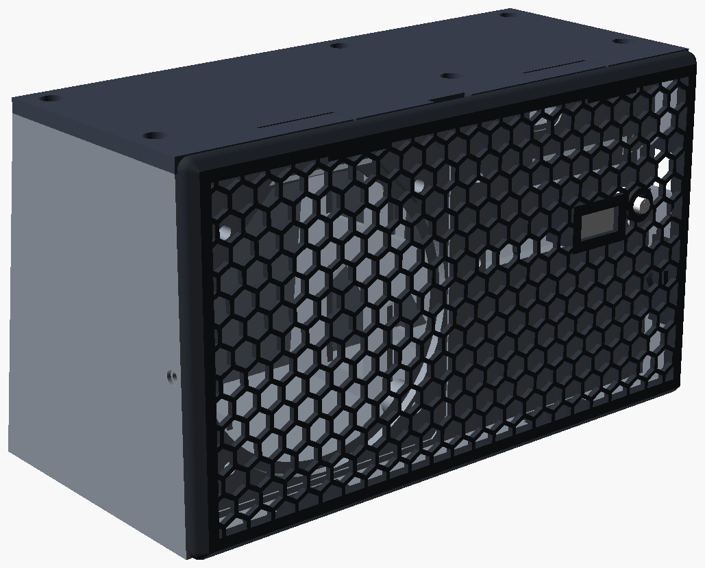
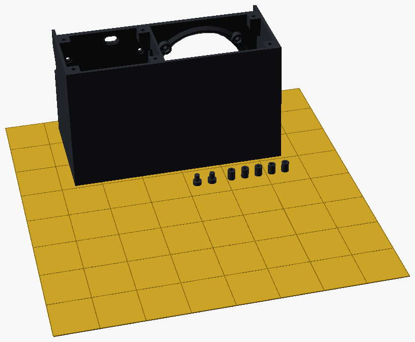
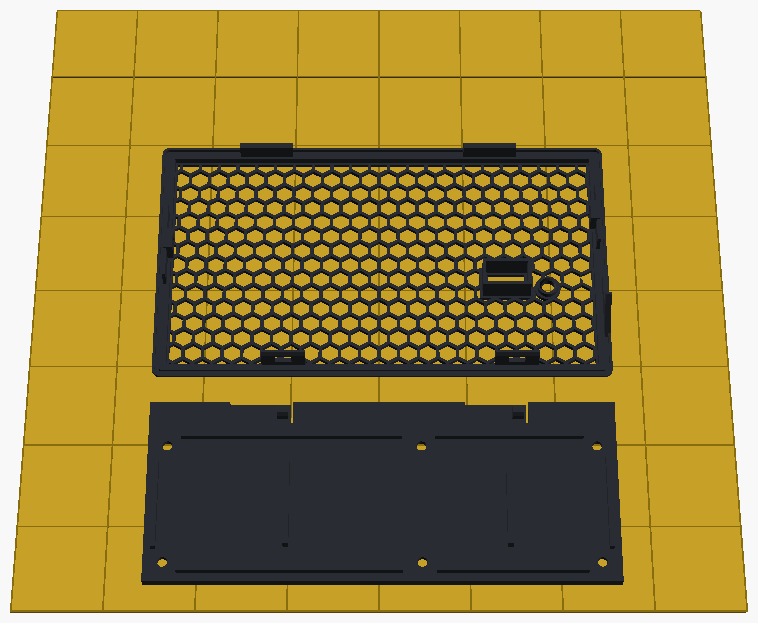
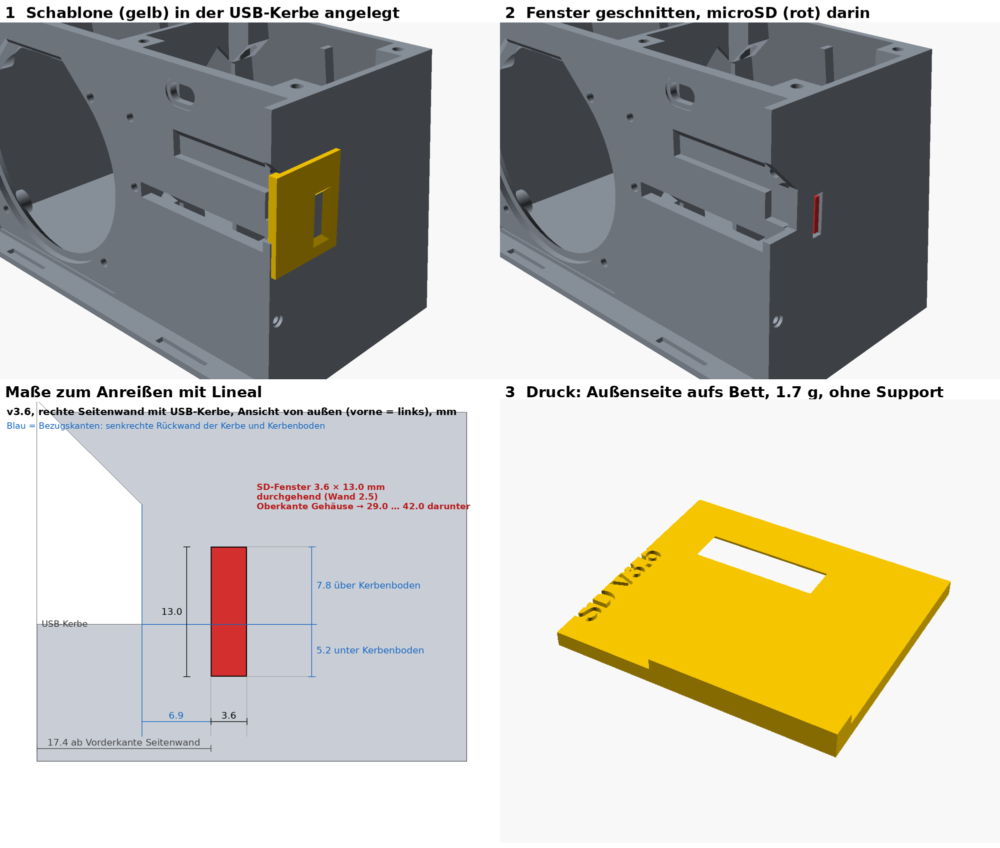
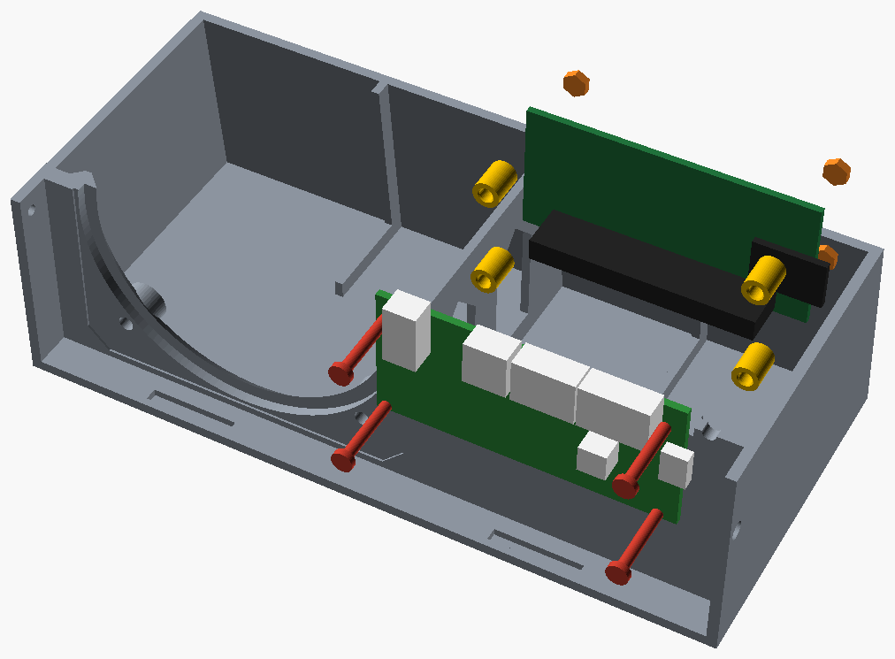
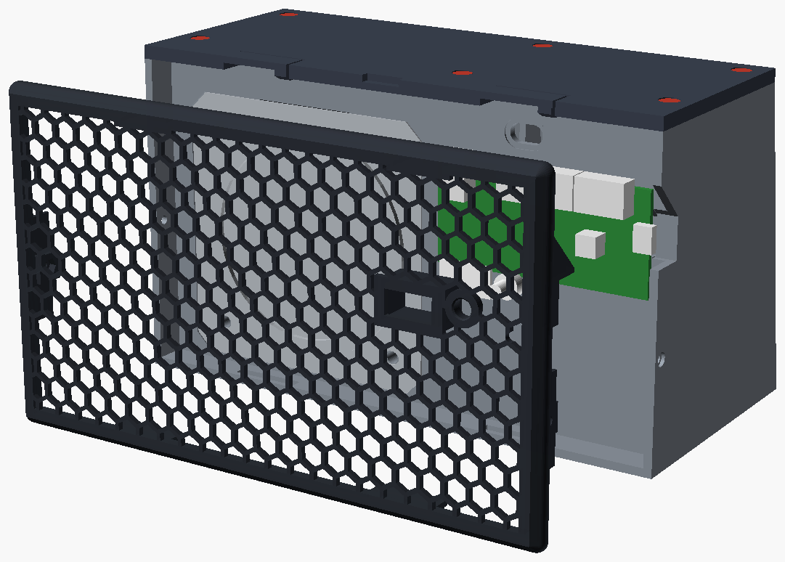

# Gehäuse v3.7

Gedrucktes Gehäuse für einen Raspberry Pi Zero 2 W, ein keyestudio ReSpeaker 2-Mic Pi HAT v1.0 und einen quadratischen 3"-Breitbandlautsprecher (Rahmen 80 × 80 mm, Lochabstand 60 × 60 mm, 4 Ω, 5 W). Außenbreite **168 mm**. Höhe und Tiefe inkl. Gitter bleiben bei **98,5 mm** und **87 mm**. Das geschlossene Nettovolumen liegt bei etwa **0,81 l**.

Die bebilderte Druck- und Montageanleitung ist [`docs/voicesat-montageanleitung.pdf`](../docs/voicesat-montageanleitung.pdf) (8 Seiten, Stand v3.7). Dieses README fasst Dateien, Druck und den OpenSCAD-Stand zusammen.



## Teile

| Datei | Inhalt | Filament |
|---|---|---|
| `stl/body.stl` | Wanne, aufrecht, offene Seite nach oben | PLA Matte schwarz |
| `stl/lid.stl` | Deckel, Oberseite auf dem Bett | PLA Matte schwarz |
| `stl/grille.stl` | Gitter, Vorderseite auf dem Bett | PLA Matte schwarz |
| `stl/spacer.stl` | Rohr Ø6 / Ø3,0 × 8,0 mm (vier plus ein Ersatz) | PLA Matte schwarz |
| `stl/plunger.stl` | Taster-Stößel (einer plus ein Ersatz) | PLA Matte schwarz |
| `stl/diffuser.stl` | LED-Diffusor, Leuchtfläche 0,6 mm | PLA Basic weiß |
| `stl/voicesat-sd-schablone.stl` | Anreißschablone nur für ein schon gedrucktes v3.6-Gehäuse | PLA Basic weiß |

In v3.7 ist die rechte Außenwand 3 mm nach außen gerückt, damit die microSD des Pi (im Gehäuse zeigt sie zur USB-Kerbe) nicht an die Wand stößt. Rohre, Stößel und Diffusor sind gegenüber v3.6 unverändert.

## 3MF-Platten

Die Dateien unter `3mf/` sind reine 3MF-Geometrie (Millimeter, benannte Objekte, schon auf dem A1-Bett platziert). Sie enthalten keine Bambu-Studio-Prozesseinstellungen. Die Montageanleitung sagt, die Meldung „load geometry data only“ beim Import sei normal und zu bestätigen. Teile danach nicht drehen und nicht **Arrange** drücken.

| Datei | Inhalt |
|---|---|
| `voicesat-case-v3.7-black-plate1.3mf` | Gehäuse, fünf Rohre, zwei Stößel |
| `voicesat-case-v3.7-black-plate2.3mf` | Deckel und Gitter |
| `voicesat-case-v3.7-black.3mf` | alle schwarzen Teile in einer Datei |
| `voicesat-case-v3.7-white.3mf` | zwei Diffusoren |
| `voicesat-weiss-diffusor-schablone.3mf` | zwei Diffusoren plus SD-Schablone |
| `voicesat-sd-schablone.3mf` | nur die SD-Schablone |

Ob Bambu Studio diese Dateien auf einem A1 genauso übernimmt, ist in dieser Arbeitskopie nicht am Slicer geprüft. Maßgeblich sind die Schritte in der PDF.





### Drucken (Bambu Lab A1, 0,4-mm-Düse)

Prozess **0.20mm Standard @BBL A1**, dann:

- **Seam position:** Aligned
- **Wall loops:** 4, **Top shell layers:** 5, **Bottom shell layers:** 4
- **Sparse infill:** 25 %, **Gyroid**
- **Enable support:** aus
- **Brim type:** No-brim
- Platte: **Textured PEI Plate**
- Schwarz: **Bambu PLA Matte**. Weiß: **Bambu PLA Basic**

Ausnahmen pro Objekt (Rechtsklick, **Add settings**):

| Objekt | Einstellung |
|---|---|
| Rohre und Stößel | Wall loops 6, Infill 100 % |
| Gitter | Infill 40 % |
| Deckel | Height range modifier 0–2,2 mm, darin Infill 100 % (Schnapplaschen) |
| Diffusor und SD-Schablone | Infill 100 % |

Schätzungen aus der PDF (PrusaSlicer 2.9.2, A1-ähnliches Profil, ohne Kalibrierung; Bambu Studio kann rund 20 % abweichen): Platte 1 etwa 204 g / 5 h 2 min, Platte 2 etwa 67 g / 2 h 26 min, zwei Diffusoren etwa 0,3 g / 1 min. Summe etwa 271 g / 7 h 29 min.

Nach dem Druck den durchhängenden Rand der 52-mm-Brücke über dem Header-Schlitz beischneiden. Den Füllzahn am Gitter (rechts, USB-Dreieck) nicht abbrechen.

## SD-Schablone

Nur für ein bereits gedrucktes v3.6-Gehäuse, bei dem die Karte an die rechte Wand stößt. Bei v3.7 entfällt sie: die Karte darf beim Einbau stecken.



`scad/sd_jig.scad` ist die Quelle der Schablone. Sie lässt sich gegen `voicesat_case.scad` (v3.7) nicht neu erzeugen, weil sich die Wand verschoben hat. Druckvorlage ist die STL/3MF. Abschnitt D der PDF beschreibt Anreißen, Bohren und den nachträglichen Karteneinschub.

Auf Seite 1 der PDF steht bei der kombinierten Weiß-Platte der Klammerzusatz „nur für v3.7-Gehäuse“. Abschnitt D und der Objektname `sd_schablone_v36` sagen das Gegenteil: die Schablone ist die v3.6-Nachrüstung. Für einen neuen v3.7-Druck reicht `voicesat-case-v3.7-white.3mf`.

## Montage, kurz

Acht Schritte, Bilder und Maße stehen in der PDF.

1. Sechs M3-Muttern von unten in die Deckel-Dome ziehen, solange die Wanne leer ist. Vorn links mit der Pinzette. Die vorderen Dome liegen später über dem Pi.
2. Lautsprecher mit vier M3x12 und M3-Scheiben von vorn, Muttern innen. Kabel am Treiber anschließen.
3. Geschlossenzelliges Schaumstoffband (etwa 3 mm breit, 2 mm dick) als Ring auf den Deckelrand.
4. HAT von vorn, vier M2.5×16 von vorn, je ein 8,0-mm-Rohr, Pi von hinten absenken und nach vorn auf die Schrauben schieben, M2.5-Muttern auf der Pi-Rückseite. Keine Scheiben. Platinenabstand 11,0 mm. Das Schraubenende liegt 0,2 mm in der Mutter (etwa vier Gänge). Nicht überziehen.
5. Lautsprecherkabel mit dem JST-Stecker durch den 10 × 5,5-mm-Schlitz in die SPEAKER-Buchse. Schlitz, Header-Schlitz und die vier HAT-Bohrungen von innen abdichten.
6. 15–25 g Polyfill links der Mittelwand, weg von Membran und Pi.
7. Deckel, sechs M3x12 über Kreuz, bis das Band etwa 1 mm zusammengedrückt ist.
8. Diffusor (glatte Seite nach vorn) und Stößel ins Gitter, Gitter unten einhaken und oben einklicken. Abnehmen über die Kerbe in der Deckelmitte.





Schrauben aus einem ISO-7380-Satz: **10 × M3×12**, **4 × M2.5×16**, **10 × M3-Muttern**, **4 × M2.5-Muttern**, **4 × M3-Scheiben**. Optional 2 × M2×6 mit Muttern, falls eine Schnapplasche ausfällt. Innensechskant 2,0 mm (M3) und 1,5 mm (M2.5).

Die PDF vermerkt, dass der Presssitz des Diffusors im Schnelltest noch nicht geprüft war.

## OpenSCAD

`scad/voicesat_case.scad` ist parametrisch (im Dateikopf: OpenSCAD 2021.01). `part` wählt das Teil. Die mitgelieferten STL sind der Export aus dem Archiv und wurden hier nicht neu gerendert.

```bash
cd case/scad
openscad -o ../stl/body.stl     -D 'part="body"'     voicesat_case.scad
openscad -o ../stl/lid.stl      -D 'part="lid"'      voicesat_case.scad
openscad -o ../stl/grille.stl   -D 'part="grille"'   voicesat_case.scad
openscad -o ../stl/spacer.stl   -D 'part="spacer"'   voicesat_case.scad
openscad -o ../stl/plunger.stl  -D 'part="plunger"'  voicesat_case.scad
openscad -o ../stl/diffuser.stl -D 'part="diffuser"' voicesat_case.scad
```

Ältere Stände (v3.2 bis v3.6) und die Hilfsskripte aus dem Entwurfsarchiv sind nicht enthalten.

## Lizenz des Gehäuses

Persönliches Remix, angeregt vom MakerWorld-Modell [„Wyoming Satellite Homeassistant Jarvis Raspi 2W“](https://makerworld.com/en/models/638687) (Modell 638687). Die HAT-Befestigung (vier Bohrungen Ø 3,0 mm auf 58,4 × 23,4 mm, Header-Schlitz 52 × 5,2 mm) ist vom Original übernommen.

Für die Gehäusedateien liegt hier **keine** eigene Open-Source-Lizenz. Was damit erlaubt ist, richtet sich nach den Bedingungen des Originalmodells auf MakerWorld. Die Skripte unter `mic-benchmark/` sind davon getrennt; ein Lizenzvorschlag dafür steht in der README im Repository-Wurzelverzeichnis.
