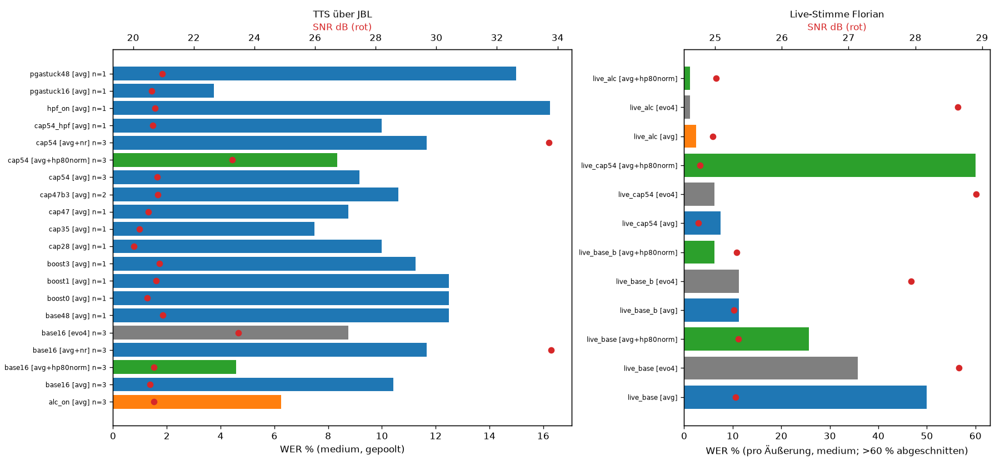

# Mikrofon-Benchmark

Messreihe vom 11.10.2026 am Pi Zero 2 W mit ReSpeaker 2-Mic HAT v1.0 (WM8960, Karte `wm8960soundcard`). Der Bericht ist [`report.md`](report.md). Die Kennzahlen stecken in den CSV- und JSON-Dateien, die Übersichtsgrafik ist [`chart_wer_snr.png`](chart_wer_snr.png).



## Ergebnis

Übernommen wurde der analoge Grundpfad **Capture 41/63** (im Setup-Skript 65 %), **Input-Boost Stufe 2 = +20 dB**, **ADC PCM 195**, **Hochpass aus**, plus **ALC Function = Stereo (3)** mit den Default-Parametern des Codecs. Gespeichert mit `sudo alsactl store`. Die gesetzten Werte stehen in [`../pi/var/lib/alsa/asound.state`](../pi/var/lib/alsa/asound.state), die Befehle in [`../pi/alsa-setup.sh`](../pi/alsa-setup.sh).

Mit echter Stimme sank die Whisper-WER (medium, int8) von **11,2 %** (Baseline, Take B) auf **2,5 %** mit ALC. Rauschunterdrückung und Aufnahme mit 48 kHz brachten keinen Gewinn. Die ALC hebt in Sprechpausen den Rauschboden an (etwa −65 auf etwa −48 dBFS). Wake-Word-Fehlauslösungen sind deshalb möglich.

Zurück zur Baseline ohne ALC, mit dem im Bericht beschriebenen Register-Trick (ASoC schreibt einen unveränderten Wert nicht neu, die PGA kann nach ALC=aus hängen bleiben):

```bash
amixer -c wm8960soundcard cset name='ALC Function' 0
amixer -c wm8960soundcard cset name='Capture Volume' 0,0
amixer -c wm8960soundcard cset name='Capture Volume' 41,41
sudo alsactl store
```

## Was fehlt

Die WAV-Aufnahmen sind absichtlich nicht enthalten. `*.wav` steht in der `.gitignore`. Ohne sie lassen sich Transkription und Metriken nicht neu rechnen.

Die Auswerteskripte (`analyze.py`, `mb.py`, `make_summary.py`, `live_*.py`, `swproc.py`, `make_playlist.py`, `play_jbl.py`) verwenden den damaligen Pfad `/workspace/mic-benchmark` und Python-Pakete wie `faster-whisper`, `jiwer`, `soundfile`, `numpy` und `scipy`. Sie sind der Stand der Auswertung, keine Installationsanleitung.

`scripts/rec.sh` und `scripts/restore.sh` sind die frühere Variante aus dem Auswertungsordner. Auf dem Pi lagen die Fassungen unter `~/micbench/`; die liegen jetzt in [`../pi/micbench/`](../pi/micbench/). `pi/micbench/restore.sh` erwartet zusätzlich `~/micbench/alsa-baseline.state` und `amixer-baseline.txt`. Diese beiden Dateien wurden nicht mit exportiert.

`xrun_test.txt` hält fest, dass bei 16 kHz und Perioden von 64 bis 1024 Frames in den geprüften 20-Sekunden-Läufen keine Overruns auftraten.
